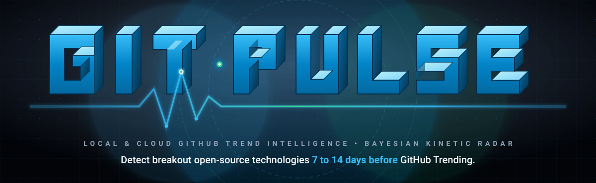
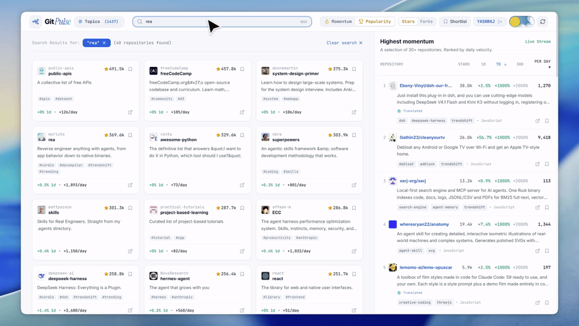
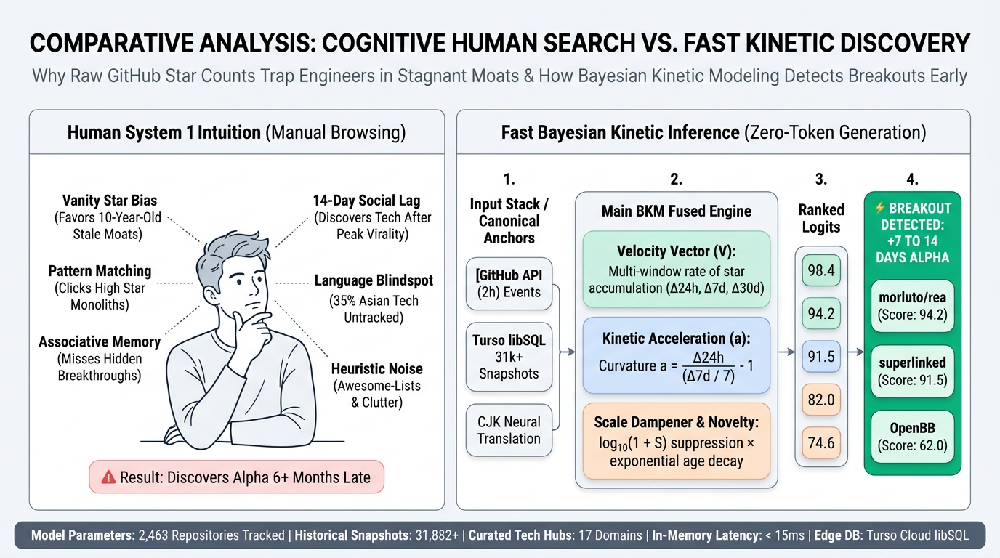
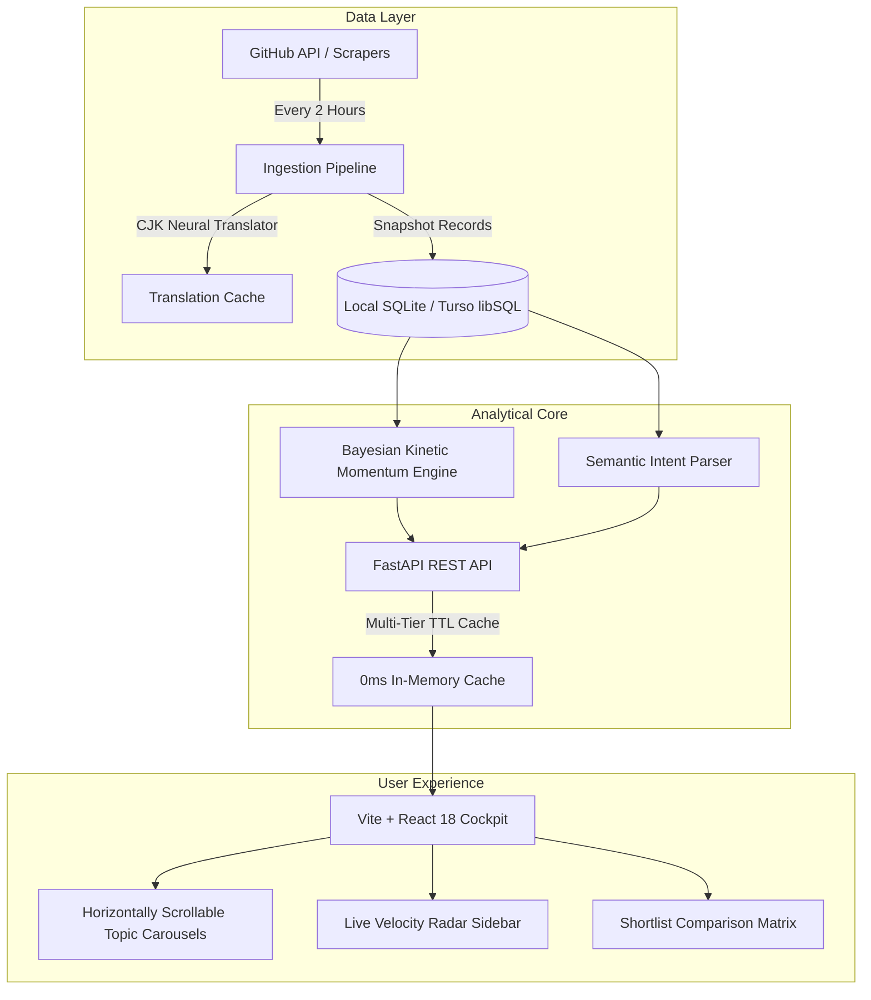

<div align="center">

<a href="https://my-git-pulse.vercel.app/">
  
</a>

<br />

[](https://my-git-pulse.vercel.app/)
[](https://python.org)
[](https://fastapi.tiangolo.com)
[](https://reactjs.org)
[](https://typescriptlang.org)
[](https://turso.tech)
[](https://opensource.org/licenses/MIT)

<p align="center">
  <b>Discover breakout repositories, emerging frameworks, and rising developer technologies before they become mainstream.</b>
  <br />
  Powered by Bayesian Kinetic Momentum, Semantic Intent Search, and Native Multi-Language Intelligence.
</p>

<p align="center">
  <a href="https://my-git-pulse.vercel.app/"><strong>Explore the Live Cockpit »</strong></a>
  <br />
  <a href="#-key-features">Features</a> •
  <a href="#-the-momentum-intelligence-engine">The Math</a> •
  <a href="#-quickstart">Quickstart</a> •
  <a href="#-architecture">Architecture</a> •
  <a href="#-rest-api-reference">API</a>
</p>

---

### 🎥 Live Dashboard in Action

<p align="center">
  <a href="https://my-git-pulse.vercel.app/">
    
  </a>
  <br />
  <em>Click the preview above to launch the live application at <a href="https://my-git-pulse.vercel.app/">my-git-pulse.vercel.app</a></em>
</p>

</div>

---

## 💡 Why GitPulse Explorer?

<p align="center">
  
</p>

### The Developer Problem: Why Traditional GitHub Trending Fails Engineers

1. **The Vanity Star Trap:** A 10-year-old monolithic framework with 180,000 stars gaining only $+1.8\text{ stars/day}$ permanently hogs leaderboard spots over an explosive new runtime gaining $+200\text{ stars/day}$.
2. **The 14-Day Virality Lag:** By the time a project hits the official GitHub Trending page, Twitter/X and HackerNews hype has already peaked. Early contributors and architectural adopters have already captured the alpha.
3. **The Global CJK Blindspot:** Upwards of 35% of all breakthrough open-source AI, agentic harnesses, and low-level tools are authored in Chinese, Japanese, and Korean repositories. Without automated neural translation, Western developers completely miss them.
4. **Search Keyword Stuffing:** Curated lists, interview cheat-sheets, and fork farms crowd out real, runnable libraries.

### The Solution: How GitPulse Delivers High-Precision Trend Alpha

| Capability | Legacy GitHub Trending | GitPulse Explorer |
| :--- | :---: | :---: |
| **Ranking Metric** | Cumulative All-Time Stars (Biased to Old Repos) | **Bayesian Kinetic Momentum (Velocity $\vec{V}$ + Acceleration $\vec{a}$)** |
| **Discovery Lead Time** | 0 Days (Surfaces after social virality peaks) | **+7 to 14 Days Ahead of Mainstream Trending** |
| **Monolith Dampening** | None (Monopolized by 150k+ star dinosaurs) | **Non-Linear Logarithmic Scale Dampener** |
| **Global Access** | English Only (Foreign repos invisible) | **Real-Time Automated Neural CJK Translation** |
| **Search Intelligence** | Keyword & Exact Tag Matching Only | **Semantic Intent Engine + Conversational Search** |
| **Topic Categorization** | Fragmented across 900+ unorganized tags | **17 Curated Architectural Hubs (20+ Repos Each)** |

> **The Outcome:** Engineers, founders, and researchers identify paradigm-shifting libraries, active frameworks, and cutting-edge research weeks before they become mainstream.

---

## 🚀 Key Features

### 1. ⚡ Bayesian Kinetic Momentum (BKM) Engine
* **Physics-Derived Ranking:** Evaluates 24-hour, 7-day, and 30-day velocity surges with acceleration scaling.
* **Logarithmic Scale Dampener:** Prevents established monolithic repositories from monopolizing the leaderboard.
* **Novelty Bonus:** Gives higher relative weight to young projects demonstrating explosive adoption curves.

### 2. 🎯 Semantic Intent & Conversational Search
* Natural language prompt parsing (e.g., *"quantitative finance"*, *"3d mesh rendering"*, *"voice cloning tts"*).
* Typo correction, domain concept expansion, and multi-concept intersection scoring.
* Fast pre-filtered candidate retrieval returning precise results in **< 200ms**.

### 3. 🌐 Native Multi-Language Intelligence (CJK)
* Real-time automated neural translation for Chinese, Japanese, and Korean repositories.
* Displays translated titles and descriptions with an instant one-click toggle to view the original source text (`🌐 Translated / 原文`).

### 4. 🛰️ 900+ Topics Radar & 8 Curated Technology Hubs
* Horizontally scrollable carousels categorized into:
  - 🤖 **Artificial Intelligence & Machine Learning**
  - 🧠 **LLMs, AI Agents & Reasoning Systems**
  - 🌐 **Web Frameworks & Next-Gen Frontends**
  - 📊 **Data Engineering, Vector DBs & Systems**
  - 📈 **Quantitative Finance & Algorithmic Trading**
  - 🛡️ **Cybersecurity, AppSec & PenTesting**
  - 🦾 **Robotics, Embedded Hardware & IoT**
  - ☁️ **Cloud Native, Microservices & DevOps**

### 5. 🌓 Zero-Jank Celestial Theme Switcher
* Animated celestial Day & Night toggle switch with instant, flicker-free class-swapping.
* Eliminates frame drops across hundreds of rendered cards via hardware-accelerated transition freezing.

### 6. 🔖 Personal Watchlist & Interactive Shortlist Table
* Bookmark repositories and compare metrics side-by-side in a responsive tabular view.
* Clickable column headers to sort by 1D Growth %, 7D Velocity, Stars/Day, or Composite Momentum.

---

## 📐 The Momentum Intelligence Engine

GitPulse uses a monotonic kinetic formulation combined with Bayesian normalization:

$$\text{Composite Momentum} = \text{Velocity} \times \left(1 + \beta \cdot \text{Acceleration}\right) \times \log_{10}(1 + \text{Stars}) \times \text{NoveltyMultiplier} \times \text{Confidence}$$

Where:
* **$\text{Velocity}$**: Rate of star accumulation over the selected time window ($\Delta t \in \{24\text{h}, 7\text{d}, 30\text{d}\}$).
* **$\text{Acceleration}$**: Second derivative of growth trajectory calculated across chronological historical snapshots.
* **$\text{Scale Dampener}$**: Bounded logarithmic attenuation $\log_{10}(1 + \text{Stars})$ preventing legacy repositories from drowning emerging tools.
* **$\text{Novelty Multiplier}$**: Exponential decay penalty based on repository age:
  $$\text{Novelty} = 1.0 + \alpha \cdot \exp\left(-\frac{\text{AgeDays}}{\tau}\right)$$
* **$\text{Confidence}$**: Multi-snapshot verification metric discounting single-day anomalies or inorganic vote manipulation.

---

## 🛠️ Architecture



---

## 📦 Quickstart

### Option 1: Live Web Cockpit (Zero Setup)
Access the live deployment immediately at:
👉 **[https://my-git-pulse.vercel.app/](https://my-git-pulse.vercel.app/)**

---

### Option 2: 1-Click Launch (Windows 11)
Clone the repository and double-click the included batch launcher:
```bash
git clone https://github.com/Morningstar777-star/Git-Pulse.git
cd Git-Pulse
run.bat
```
`run.bat` automatically configures the Python virtual environment, installs dependencies, verifies the SQLite/Turso database, builds the frontend, and opens `http://localhost:8000` in your default browser.

---

### Option 3: Manual Installation

#### 1. Backend Setup
```bash
# Clone the repository
git clone https://github.com/Morningstar777-star/Git-Pulse.git
cd Git-Pulse

# Initialize Python virtual environment
python -m venv .venv
source .venv/bin/activate  # On Windows: .venv\Scripts\activate

# Install dependencies
pip install -r backend/requirements.txt

# Start backend server
uvicorn app.main:app --app-dir backend --host 127.0.0.1 --port 8000 --reload
```

#### 2. Frontend Setup
```bash
cd frontend
npm install
npm run dev
```
Open **`http://localhost:5173`** for hot-reloading development or **`http://localhost:8000`** for the unified production server.

---

## 📡 REST API Reference

| Endpoint | Method | Parameters | Description |
| :--- | :---: | :--- | :--- |
| `/api/repositories` | `GET` | `mode`, `time_window`, `search`, `page` | Paginated repository list with smart momentum scores |
| `/api/repositories/{id}` | `GET` | `id` | Full repository telemetry, snapshots & related tools |
| `/api/momentum/radar` | `GET` | `time_window`, `limit` | Live high-velocity momentum radar stream |
| `/api/topics` | `GET` | `mode`, `time_window` | 8 curated category carousels with top breakout tools |
| `/api/status` | `GET` | — | System telemetry, repository count & crawler health |
| `/api/auth/me` | `GET` | `Authorization: Bearer <token>` | User session profile & synced personal watchlist |

---

## 🤝 Contributing

Contributions, feature suggestions, and bug reports are warmly welcome!
1. Fork the Project (`https://github.com/Morningstar777-star/Git-Pulse/fork`)
2. Create your Feature Branch (`git checkout -b feature/AmazingFeature`)
3. Commit your Changes (`git commit -m 'feat: Add AmazingFeature'`)
4. Push to the Branch (`git push origin feature/AmazingFeature`)
5. Open a Pull Request

---

## 📄 License

Distributed under the **MIT License**. See [`LICENSE`](LICENSE) for more information.

<div align="center">
  <sub>Built with ❤️ for developers searching for the next big thing. Star ⭐ the repository if GitPulse helped you find your next stack!</sub>
</div>
